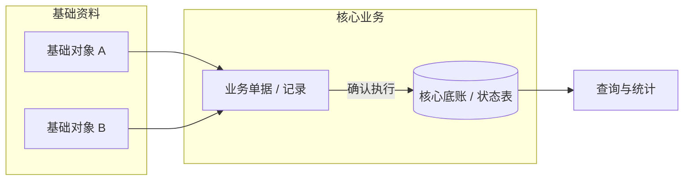

# 04-功能模块与数据依赖

> 分期标注约定：**【一期】** 必做闭环 · **【一期·轻】** 做但不做重（详见 `07`） · **【二期】** 明确后置 · **【三期/待定】** 远期或边界外。

## 一、功能模块清单

### 模块一：【基础资料 / 基础底座】

| 子模块 / 对象 | 核心功能点 | 分期 |
|---|---|---|
| 【对象 A】 | 搜索、新增、编辑、查看；启用 / 停用 | 【一期】 |
| 【对象 B】 | 【待确认】 | 【一期】 |

### 模块二：【核心业务模块 A】

| 子模块 / 单据 | 核心功能点 | 分期 |
|---|---|---|
| 【功能 / 单据 A】 | 【待确认】 | 【一期】 |
| 【轻量能力】 | 【待确认】 | 【一期·轻】 |
| 【后置能力】 | 【待确认】 | 【二期】 |

### 模块三：【核心业务模块 B】

| 子模块 / 单据 | 核心功能点 | 分期 |
|---|---|---|
| 【功能 / 单据 B】 | 【待确认】 | 【一期】 |

### 一期模块总览（速查）

| 模块 | 一期核心能力 | 二期主要增量 |
|---|---|---|
| 【模块一】 | 【待确认】 | — |
| 【模块二】 | 【待确认】 | 【待确认】 |

## 二、模块间数据依赖关系

> 描述**模块级数据流向**（不是页面导航菜单），明确哪一块是共用底座、哪一块是核心底账。

**关键依赖说明**：

| 上游 | 下游 | 传递内容 | 依据 |
|---|---|---|---|
| 【基础资料】 | 【核心业务】 | 档案主键与默认配置 | `context/05` |
| 【待确认】 | 【待确认】 | 【待确认】 | 【待确认】 |

## 三、后续扩展模块与开启条件

| 后置能力 | 分期 | 暂不做原因 | 建议开启条件 |
|---|---|---|---|
| 【后置能力 1】 | 【二期】 | 【待确认】 | 【待确认】 |
| 【远期能力 2】 | 【三期/待定】 | 【待确认】 | 【待确认】 |
