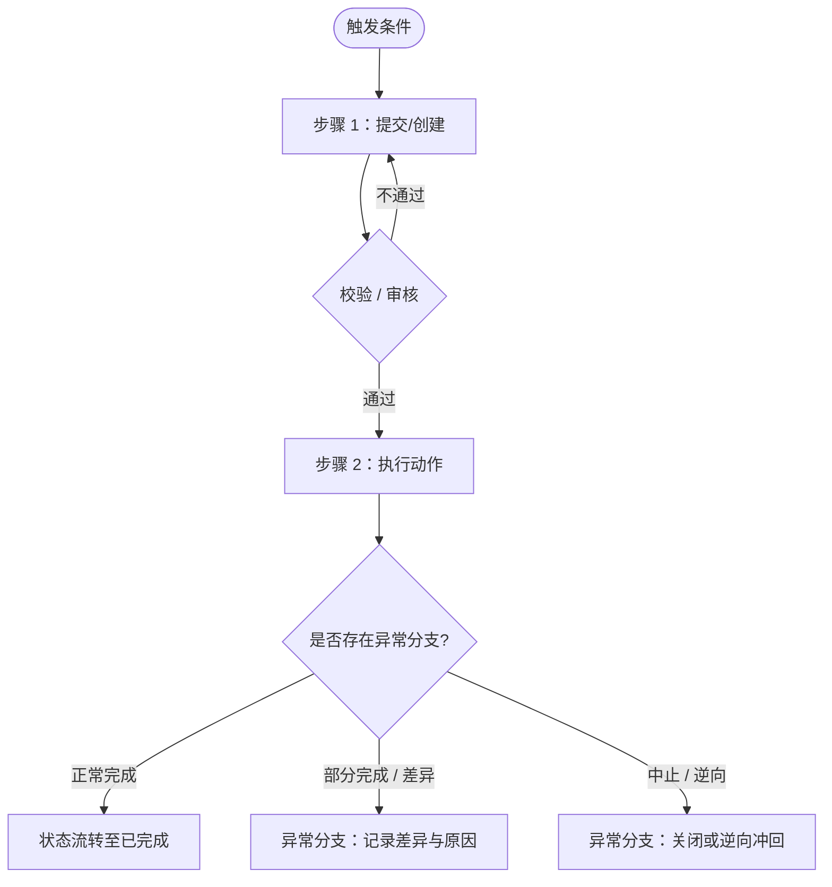

# 06-核心业务场景与流程

## 一、核心场景总览

| 场景名称 | 频次 | 涉及角色 | 核心链路 | 本期重点 |
|---|---|---|---|---|
| 【场景一】 | 很高 | 【待确认】 | 【待确认】 | 【主链路】 |
| 【场景二】 | 高 | 【待确认】 | 【待确认】 | 【待确认】 |
| 【场景三】 | 中 | 【待确认】 | 【待确认】 | 【待确认】 |

---

## 二、场景一：【场景名称】（按需复制本节扩展场景二、三…）

### 参与角色

| 角色 | 业务动作 | 系统操作 |
|---|---|---|
| 【角色 A】 | 【待确认】 | 【待确认】 |
| 【角色 B】 | 【待确认】 | 【待确认】 |

### 当前痛点

- 【待确认】

### 落地方案（分层思考）

- **本期必做（第一层）**：【待确认】
- **后续补强（第二层）**：【待确认】（写明本期不做原因）

### 主流程（含正常路径与异常分支）

### 异常分支说明

| 异常分支 | 触发条件 | 系统处理方式 | 终态 |
|---|---|---|---|
| 【部分完成 / 差异】 | 【待确认】 | 【待确认】 | 【待确认】 |
| 【取消 / 关闭 / 逆向】 | 【待确认】 | 【待确认】 | 【待确认】 |

### 关键业务规则

| 规则编号 | 规则描述 | 校验时机 | 违反处理 |
|---|---|---|---|
| `R1-01` | 【待确认】 | 保存 / 提交 | 字段下方红色提示，阻断提交 |
| `R1-02` | 【待确认】 | 确认执行 | 【待确认】 |

---

## 三、非核心但需预留扩展位的场景

| 场景 | 当前情况 | 本期处理策略 |
|---|---|---|
| 【次要场景 A】 | 【待确认】 | 【保留基础记录 / 留入口 / P2】 |
| 【次要场景 B】 | 【待确认】 | 【待确认】 |
